# Задание 2, модули 5-8. University Course Management API

Продолжение [задания 1](../Assignment01): тот же REST API для управления университетскими курсами, в который добавлены безопасность, управление пользователями и версионирование. Вся база задания 1 на месте, здесь лежит полная версия проекта.

Структура README:

- разделы до «Проверенные сценарии» описывают основу из задания 1: слои, EF Core, DTO, AutoMapper, единый формат ответа;
- раздел «Задание 2» в конце описывает новое: JWT, ASP.NET Core Identity, роли, CORS, клиентское приложение и версии API.

Стек: .NET 10, ASP.NET Core Web API, EF Core 10 с провайдером Npgsql, PostgreSQL 17 в Docker, AutoMapper, ASP.NET Core Identity, JWT Bearer, Asp.Versioning, Swagger.

## Запуск

Поднять базу:

```bash
docker compose up -d
```

Задать ключ подписи JWT, в репозитории его нет:

```bash
dotnet user-secrets --project UniversityApi set "Jwt:Key" "любая-длинная-случайная-строка-не-короче-32-символов"
```

Вместо user-secrets можно передать переменную окружения `Jwt__Key`. Без ключа приложение не стартует и пишет об этом в консоль.

Запустить API из папки Assignment02:

```bash
dotnet run --project UniversityApi --launch-profile https
```

Клиентское приложение запускается отдельно, порты 5300 и 7300:

```bash
dotnet run --project UniversityClient --launch-profile https
```

Swagger открывается сам на https://localhost:7200/swagger, HTTP-порт 5200.

При старте приложение само применяет миграции и, если база пустая, заполняет её тестовыми данными: 3 преподавателя, 4 студента, 4 курса, 4 записи на курсы.

Готовый дамп базы с тестовыми данными лежит в `db/dump.sql`, восстановить можно так:

```bash
docker exec -i university-db psql -U postgres -d university < db/dump.sql
```

## Архитектура

```
Client (Swagger, Postman, веб или мобильное приложение)
  |  HTTP
Controller       принимает запрос, отдаёт ReturnResult, больше ничего не делает
  |
Service          бизнес-правила, проверки, логирование, маппинг DTO
  |
Repository       запросы к данным, никакой бизнес-логики
  |
Entity Framework Core
  |
PostgreSQL
```

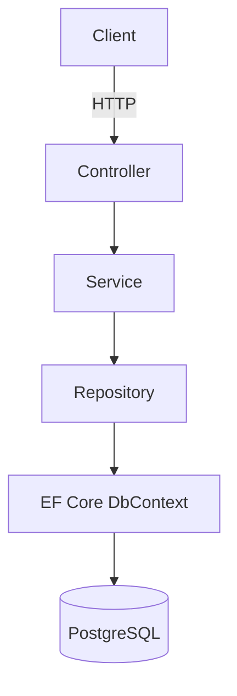

Структура проекта:

```
UniversityApi
├── Controllers      StudentsController, TeachersController, CoursesController, EnrollmentsController
├── Models           Student, Teacher, Course, Enrollment
├── Dtos             отдельные DTO на чтение, создание и обновление
├── Data             ApplicationDbContext, DbSeeder
├── Repositories     Interfaces и Implementations
├── Services         Interfaces и Implementations, бизнес-правила
├── Mapping          MappingProfile для AutoMapper
├── Middleware       ExceptionHandlingMiddleware
├── Common           ReturnResult, ApiException, ErrorCodes
├── Migrations       миграции EF Core
└── Program.cs       регистрация зависимостей и конвейер
```

## Endpoints

Students:

| Метод | URL | Назначение | Коды |
|---|---|---|---|
| GET | `/api/students` | все студенты | 200 |
| GET | `/api/students/{id}` | студент по id | 200, 404 |
| GET | `/api/students/{id}/courses` | студент вместе с его курсами и оценками | 200, 404 |
| POST | `/api/students` | создать студента | 201, 400, 409 |
| PUT | `/api/students/{id}` | изменить студента | 200, 400, 404, 409 |
| DELETE | `/api/students/{id}` | удалить студента | 200, 404 |

Teachers:

| Метод | URL | Назначение | Коды |
|---|---|---|---|
| GET | `/api/teachers` | все преподаватели | 200 |
| GET | `/api/teachers/{id}` | преподаватель по id | 200, 404 |
| POST | `/api/teachers` | создать преподавателя | 201, 400, 409 |
| PUT | `/api/teachers/{id}` | изменить преподавателя | 200, 400, 404, 409 |
| DELETE | `/api/teachers/{id}` | удалить преподавателя | 200, 404 |

Courses:

| Метод | URL | Назначение | Коды |
|---|---|---|---|
| GET | `/api/courses` | все курсы, есть фильтры `teacherId`, `minCredits`, `search` | 200 |
| GET | `/api/courses/{id}` | курс по id | 200, 404 |
| POST | `/api/courses` | создать курс и привязать преподавателя | 201, 400, 404 |
| PUT | `/api/courses/{id}` | изменить курс | 200, 400, 404 |
| DELETE | `/api/courses/{id}` | удалить курс | 200, 404 |

Enrollments:

| Метод | URL | Назначение | Коды |
|---|---|---|---|
| GET | `/api/enrollments` | все записи | 200 |
| GET | `/api/enrollments/{id}` | запись по id | 200, 404 |
| POST | `/api/enrollments` | записать студента на курс | 201, 400, 404, 409 |
| PUT | `/api/enrollments/{id}/grade` | изменить оценку | 200, 400, 404 |
| DELETE | `/api/enrollments/{id}` | снять студента с курса | 200, 404 |

Пример фильтрации: `/api/courses?minCredits=5`, `/api/courses?search=web`, `/api/courses?teacherId=1`.

## Единый формат ответа

Любой endpoint возвращает `ReturnResult<T>`.

Успех:

```json
{
  "statusCode": 201,
  "isSuccess": true,
  "result": { "id": 5, "firstName": "Nurlan", "lastName": "Sultanov" },
  "errorCode": null,
  "errorMessage": null,
  "traceId": "0HNOT51ETVM7D:00000001"
}
```

Ошибка:

```json
{
  "statusCode": 404,
  "isSuccess": false,
  "result": null,
  "errorCode": "STUDENT_NOT_FOUND",
  "errorMessage": "Student not found",
  "traceId": "0HNOT51ETVM7I:00000001"
}
```

Коды ошибок:

| errorCode | HTTP | Когда возникает |
|---|---|---|
| VALIDATION_ERROR | 400 | DTO не прошёл валидацию |
| STUDENT_NOT_FOUND | 404 | студента с таким id нет |
| TEACHER_NOT_FOUND | 404 | преподавателя с таким id нет |
| COURSE_NOT_FOUND | 404 | курса с таким id нет |
| ENROLLMENT_NOT_FOUND | 404 | записи с таким id нет |
| EMAIL_ALREADY_EXISTS | 409 | email уже занят |
| DUPLICATE_ENROLLMENT | 409 | студент уже записан на этот курс |
| INTERNAL_SERVER_ERROR | 500 | непредвиденная ошибка |

## Бизнес-правила

1. Нельзя записать студента на несуществующий курс, возвращается 404 COURSE_NOT_FOUND.
2. Нельзя записать несуществующего студента, возвращается 404 STUDENT_NOT_FOUND.
3. Один студент не может быть дважды записан на один курс. Проверка в сервисе плюс уникальный индекс по паре StudentId и CourseId в базе, ответ 409 DUPLICATE_ENROLLMENT.
4. Курс не может ссылаться на несуществующего преподавателя, при создании и изменении курса возвращается 404 TEACHER_NOT_FOUND.
5. Запрос несуществующего объекта никогда не возвращается как успех, всегда 404 с описанием.

Дополнительно email студента и преподавателя уникален, повтор даёт 409.

## Конфигурация моделей EF Core

Использованы три способа сразу:

- Conventions: свойство `Id` становится первичным ключом, свойства `StudentId` и `CourseId` распознаются как внешние ключи.
- Data Annotations: в `Student` и `Teacher` стоят `[Required]`, `[MaxLength]` и `[EmailAddress]`.
- Fluent API: в `ApplicationDbContext` настроены курс и запись на курс. Заданы длины строк, обязательные поля, связи, поведение при удалении и уникальные индексы.

Связи: у преподавателя много курсов (удаление преподавателя с курсами запрещено, Restrict), у студента и у курса много записей (записи удаляются каскадом).

## Dependency Injection и время жизни

Всё регистрируется в `Program.cs`, контроллеры получают зависимости через конструктор, `new` для репозиториев нигде нет.

Репозитории и сервисы зарегистрированы как Scoped, то есть один экземпляр на HTTP-запрос. Это совпадает со временем жизни `DbContext`, который тоже Scoped: в рамках одного запроса все работают с одним контекстом и видят одни и те же отслеживаемые сущности. Singleton не подходит, потому что `DbContext` не потокобезопасен и один экземпляр на всё приложение ломался бы при параллельных запросах. Transient создавал бы несколько разных контекстов внутри одного запроса, и изменения из одного репозитория не были бы видны другому.

## Валидация

Проверяются DTO через атрибуты: имя и фамилия обязательны и не длиннее 50 символов, email обязателен и должен быть корректным, название курса обязательно, кредиты от 1 до 10, оценка от 0 до 100, идентификаторы положительные.

Стандартный ответ ASP.NET Core заменён своим: `InvalidModelStateResponseFactory` в `Program.cs` возвращает тот же `ReturnResult` с кодом 400 и errorCode VALIDATION_ERROR, чтобы формат ответа не отличался от остальных.

## Логирование

Используется `ILogger` в сервисах и middleware:

- Information: создание, изменение и удаление объектов, запись студента на курс, заполнение базы тестовыми данными.
- Warning: попытка получить несуществующий объект, повторная запись на курс, занятый email.
- Error: непредвиденные исключения, пишутся вместе со стеком в `ExceptionHandlingMiddleware`.

## Обработка исключений

`ExceptionHandlingMiddleware` стоит первым в конвейере. Свои ошибки бизнес-логики (`ApiException`) превращаются в ответ с нужным HTTP-кодом и errorCode. Любое другое исключение логируется с деталями и превращается в ответ 500 с errorCode INTERNAL_SERVER_ERROR. Клиент не видит ни стека, ни SQL, ни внутренних деталей.

## Скриншоты Swagger

Список endpoints:

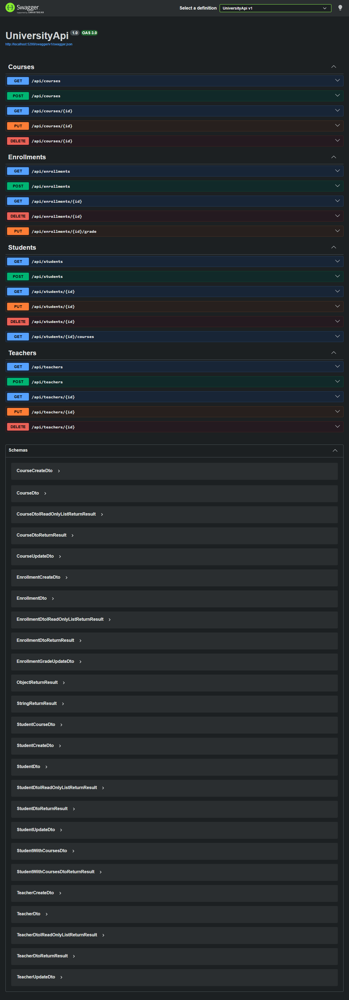

Получение списка студентов:

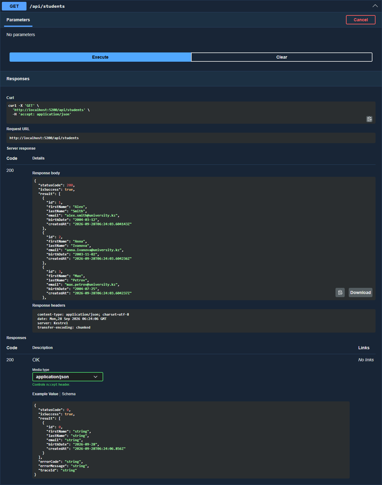

Создание студента, 201:

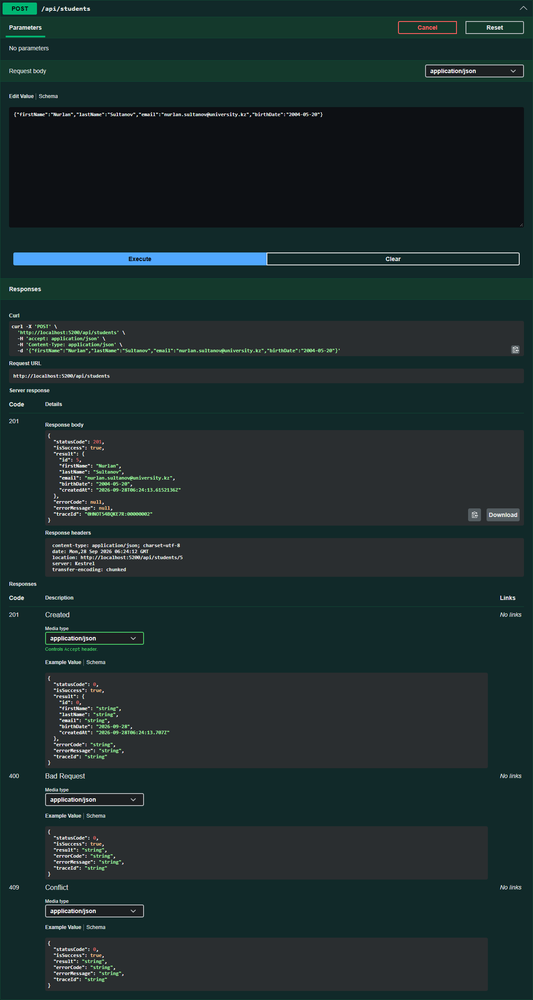

Запись студента на курс, 201:

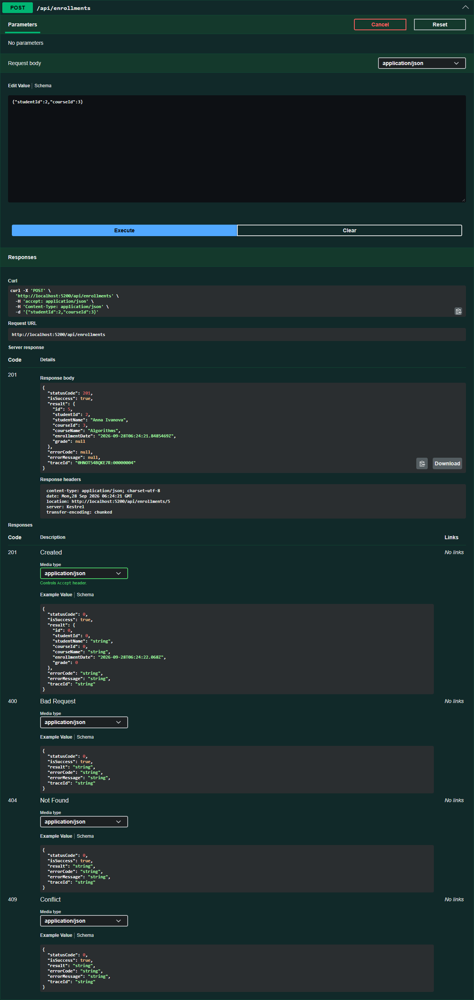

Повторная запись на тот же курс, 409:

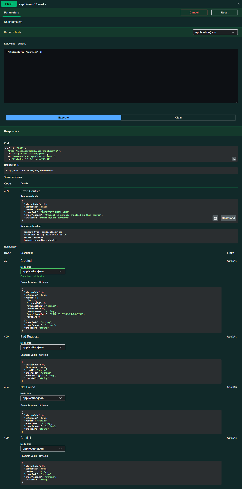

Ошибка валидации, 400:

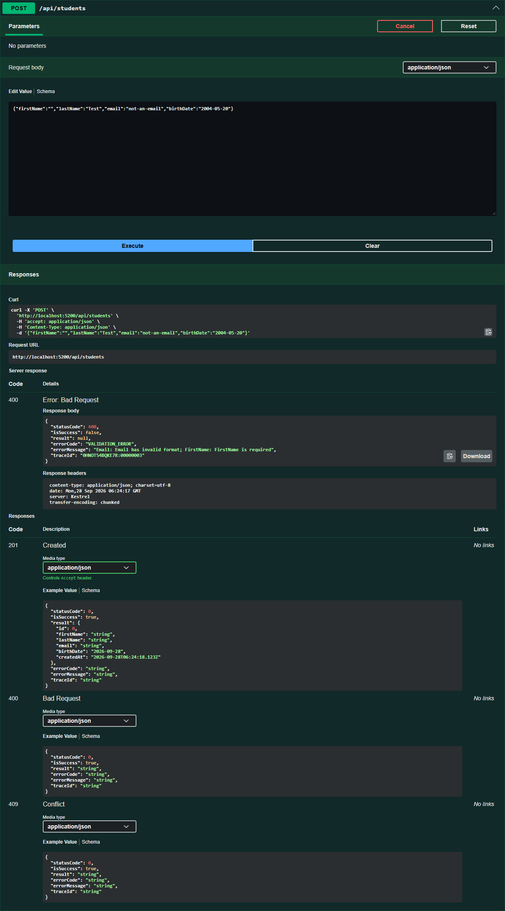

Несуществующий студент, 404:

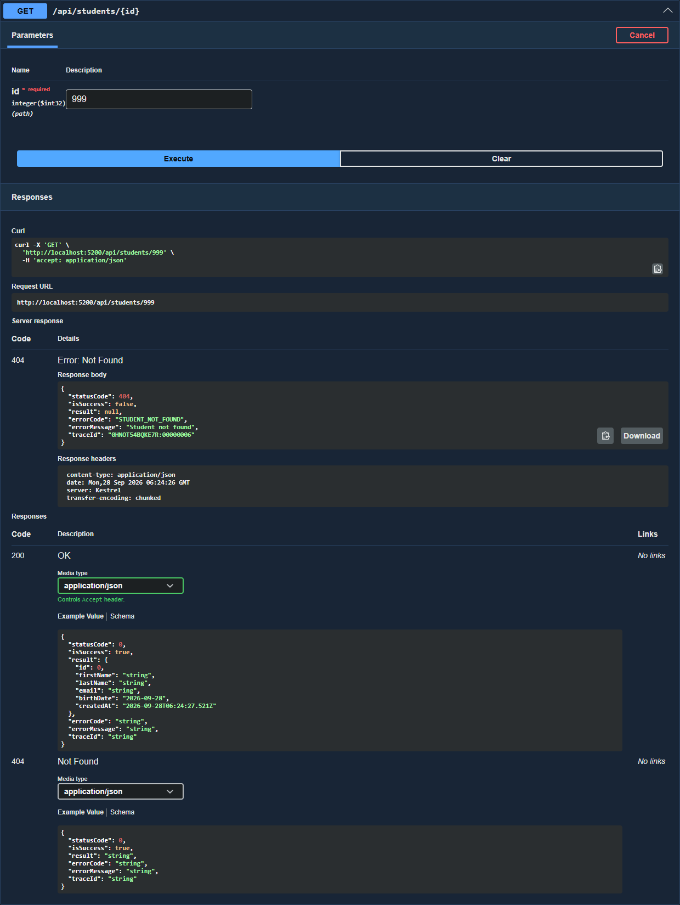

## Проверенные сценарии

Все пункты из задания прогнаны через HTTP-запросы к API:

| Сценарий | Результат |
|---|---|
| Список студентов | 200 |
| Создание студента | 201 |
| Получение созданного студента по id | 200 |
| Изменение студента | 200 |
| Создание преподавателя | 201 |
| Создание курса с привязкой преподавателя | 201 |
| Запись студента на курс | 201 |
| Повторная запись на тот же курс | 409 DUPLICATE_ENROLLMENT |
| Студент вместе с курсами | 200 |
| Фильтрация курсов по кредитам и названию | 200 |
| Удаление записи с курса | 200 |
| Получение несуществующего студента | 404 STUDENT_NOT_FOUND |
| Пустое имя и кривой email | 400 VALIDATION_ERROR |
| Курс с несуществующим преподавателем | 404 TEACHER_NOT_FOUND |
| Запись несуществующего студента | 404 STUDENT_NOT_FOUND |
| Записи событий в логах | Information, Warning, Error |

# Задание 2, модули 5-8. Безопасность и версионирование

Функциональность задания 1 сохранена полностью: прежние маршруты, контракты и коды ответов работают как раньше, CRUD, Repository, DTO и AutoMapper не переписывались.

## Аутентификация и авторизация

Аутентификация отвечает на вопрос «кто ты». Пользователь отправляет логин и пароль в `POST /api/auth/login`, Identity сверяет пароль с хешем и выдаёт JWT.

Авторизация отвечает на вопрос «что тебе можно». При каждом запросе из токена читаются роли и claims, и по ним решается, пускать ли к endpoint и к конкретному объекту.

Пример из этого приложения: teacher1 успешно входит и получает 200 на `PUT /api/enrollments/1/grade`, потому что курс его. С тем же самым токеном он получает 403 на `PUT /api/enrollments/4/grade`, потому что курс чужой. Аутентификация одна и та же, решение авторизации разное.

## Схема прохождения запроса

```
Client (Swagger, Postman, UniversityClient)
   |  HTTP, заголовок Authorization: Bearer <JWT>
ExceptionHandlingMiddleware   приводит любые ошибки к единому ReturnResult
   |
UseCors                       пропускает только разрешённые адреса клиентов
   |
UseAuthentication             проверяет подпись, issuer, audience и срок токена,
   |                          собирает ClaimsPrincipal с ролями и claims
UseAuthorization              проверяет [Authorize] и требуемые роли
   |
Controller                    только приём запроса и формирование ответа
   |
Service                       бизнес-правила и проверка владения ресурсом
   |                          (teacherId и studentId берутся из claims токена)
Repository  ->  EF Core  ->  PostgreSQL
```

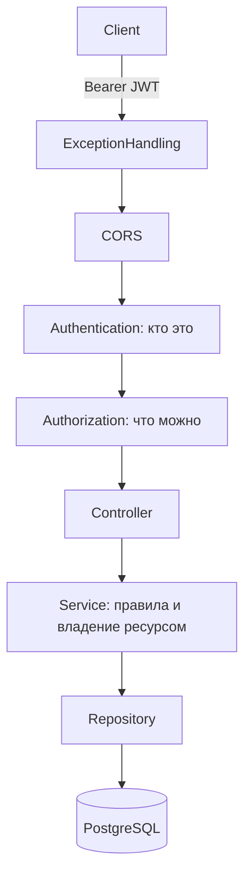

Порядок важен: `UseAuthentication` обязательно идёт до `UseAuthorization`, иначе к моменту проверки прав пользователь ещё неизвестен и любой защищённый endpoint отвечал бы 401.

## JWT

Токен выдаётся в `POST /api/auth/login` и передаётся в заголовке `Authorization: Bearer <токен>`.

Внутри токена: идентификатор пользователя, имя пользователя, роли, а также `teacherId` или `studentId`, если учётная запись связана с преподавателем или студентом. Благодаря этому проверка владения ресурсом не требует лишнего похода в базу.

Проверяется подпись (HS256), издатель, аудитория и срок действия, `ClockSkew` выставлен в ноль, чтобы просроченный токен отклонялся сразу. Срок жизни токена 30 минут, настраивается в `Jwt:AccessTokenMinutes`.

Ключ подписи в репозитории не хранится: он читается из user-secrets или переменной окружения `Jwt__Key`. В `appsettings.json` лежат только Issuer, Audience и время жизни. Если ключа нет, приложение падает на старте с понятным сообщением, а не работает с пустым ключом.

Подделанный, изменённый или просроченный токен даёт 401 в том же формате ReturnResult, что и остальные ответы:

```json
{
  "statusCode": 401,
  "isSuccess": false,
  "result": null,
  "errorCode": "UNAUTHORIZED",
  "errorMessage": "Authentication is required",
  "traceId": "0HNPDP38IRARC:00000007"
}
```

## ASP.NET Core Identity

Identity подключён через EF Core, таблицы `AspNetUsers`, `AspNetRoles` и остальные лежат в той же базе. Пароли хранит сам Identity в виде хешей, своего хеширования в проекте нет.

- `POST /api/auth/register` создаёт пользователя, имя пользователя уникально, повтор даёт 409 USER_ALREADY_EXISTS.
- Регистрация всегда выдаёт только роль Student, получить Admin при регистрации нельзя.
- `POST /api/auth/login` проверяет пароль через `SignInManager.CheckPasswordSignInAsync` с учётом блокировок.
- `GET /api/auth/me` возвращает текущего пользователя, его роли и привязку к преподавателю или студенту.
- Требования к паролю: не короче 8 символов, обязательны цифра, строчная и заглавная буквы и спецсимвол.
- После 5 неудачных попыток входа учётная запись блокируется на 5 минут, ответ 401 ACCOUNT_LOCKED даже при верном пароле.
- В ответах API нет ни паролей, ни хешей, в логи они тоже не пишутся.

## Роли и разграничение доступа

| Роль | Что может |
|---|---|
| Admin | управление пользователями и ролями, полный доступ к данным университета |
| Teacher | просмотр курсов и студентов, выставление оценок только по своим курсам |
| Student | просмотр курсов, своих записей и своих оценок |

Публично доступны только чтение курсов (`GET /api/courses`, `GET /api/v1/courses`, `GET /api/v2/courses`), регистрация и вход. Создание, изменение и удаление студентов, преподавателей, курсов и записей анонимно недоступно.

Проверки владения ресурсом сделаны в сервисах, потому что одной роли мало:

- студент видит только свои данные и свои оценки, запрос чужих даёт 403;
- студент может записать на курс только самого себя;
- преподаватель ставит оценку только по курсу, который за ним закреплён;
- назначение ролей доступно только админу, поэтому поднять себе права через API нельзя.

Без этих проверок роль Teacher означала бы «может менять любые оценки», а роль Student давала бы доступ к данным любого студента. Роль отвечает на вопрос «какого типа пользователь», а не «его ли это объект».

Учётные записи связаны с сущностями: у пользователя с ролью Teacher заполнен `TeacherId`, у Student заполнен `StudentId`. Связку задаёт админ через `POST /api/auth/users/{id}/roles`.

## Версионирование API

Подключён Asp.Versioning с версией в сегменте URL.

| Маршрут | Версия | Что возвращает |
|---|---|---|
| `GET /api/courses` | v1 по умолчанию | прежний контракт задания 1 |
| `GET /api/v1/courses` | v1 | то же самое |
| `GET /api/v2/courses` | v2 | курс вместе с объектом преподавателя и числом записанных студентов |

Ответ v1, контракт не изменился:

```json
{ "id": 1, "name": "Web Services", "credits": 5, "teacherId": 2, "teacherName": "Evgeniy Gertsen" }
```

Ответ v2, расширенный контракт со своим DTO:

```json
{
  "id": 1,
  "name": "Web Services",
  "credits": 5,
  "teacher": { "id": 2, "fullName": "Evgeniy Gertsen", "email": "e.gertsen@university.kz", "department": "Software Engineering" },
  "enrolledStudents": 2
}
```

Бизнес-логика не дублируется: обе версии вызывают один и тот же `ICourseService` и один репозиторий, отличаются только DTO и маппинг. Старый маршрут `/api/courses` остался рабочим, поэтому клиенты первой версии ничего не замечают.

Swagger отдаёт два документа, v1 и v2, они переключаются в выпадающем списке вверху страницы.

## CORS и клиентское приложение

Именованная политика `UniversityClients` разрешает запросы с двух адресов клиента, они заданы в `appsettings.json` в секции `Cors:AllowedOrigins`.

`UniversityClient` это отдельное приложение ASP.NET Core MVC. Оно ходит в API по HTTP через `IHttpClientFactory` (типизированный клиент `CoursesApiClient`) и не обращается к базе напрямую. Адрес API задаётся в `appsettings.json` в `UniversityApi:BaseUrl`, в коде он не зашит.

Клиент показывает список курсов и карточку одного курса. Ошибки обрабатываются: если API выключен, страница пишет «API недоступен, проверьте, что сервис запущен», если курса нет, пишет «Запрошенные данные не найдены», при прочих неуспешных кодах показывает код и сообщение из ответа API.

## Тестовые пользователи

Создаются автоматически при первом запуске, пароли берутся из секции `SeedUsers`. Те же пользователи есть в дампе `db/dump.sql`.

| Логин | Пароль | Роль | Привязка |
|---|---|---|---|
| admin | Admin123$ | Admin | нет |
| teacher1 | Teacher123$ | Teacher | Evgeniy Gertsen, курс Web Services |
| teacher2 | Teacher123$ | Teacher | Farida Abdoldina |
| student1 | Student123$ | Student | Alex Smith |
| student2 | Student123$ | Student | Anna Ivanova |

## Сценарии безопасности

Все сценарии прогнаны через HTTP-запросы к запущенному API.

| № | Сценарий | Ожидалось | Получилось |
|---|---|---|---|
| 1 | аноним запрашивает список курсов | 200 | 200 |
| 2 | аноним создаёт курс | 401 | 401 UNAUTHORIZED |
| 3 | неправильный пароль | без токена | 401 INVALID_CREDENTIALS, токена нет |
| 4 | вход с верными данными | JWT | 200, токен выдан |
| 5 | просроченный JWT | 401 | 401 UNAUTHORIZED |
| 6 | Student удаляет курс | 401 по методичке | 403 FORBIDDEN, пояснение ниже |
| 7 | Teacher ставит оценку на своём курсе | 200 | 200 |
| 8 | Teacher ставит оценку на чужом курсе | 403 | 403 FORBIDDEN |
| 9 | Student запрашивает чужие оценки | 403 | 403 FORBIDDEN |
| 10 | Admin назначает роль | успех | 200, роль изменена |
| 11 | Student назначает себе Admin | 403 | 403 FORBIDDEN |
| 12 | обращение к v1 и v2 | обе работают | 200 и 200, контракты разные |

Дополнительно проверено: 5 неудачных входов подряд блокируют учётную запись, и даже верный пароль после этого даёт 401 ACCOUNT_LOCKED.

По сценарию 6 в таблице задания стоит 401, но пункт 2 того же задания требует возвращать 403, когда пользователь аутентифицирован, но прав не хватает. Студент с действующим токеном это как раз такой случай, поэтому API отвечает 403. Анонимный запрос на удаление курса возвращает 401, как и требуется.

## Скриншоты

Swagger с кнопкой Authorize и двумя версиями:

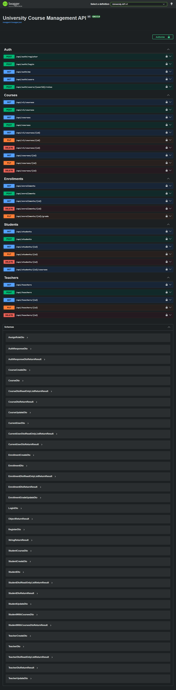

Окно ввода JWT:

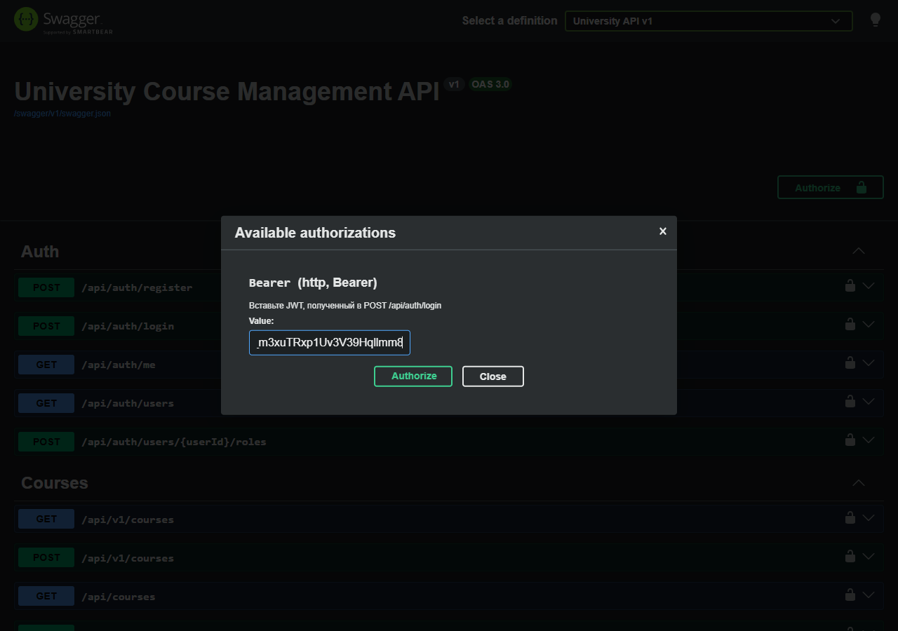

Вход и выдача токена:

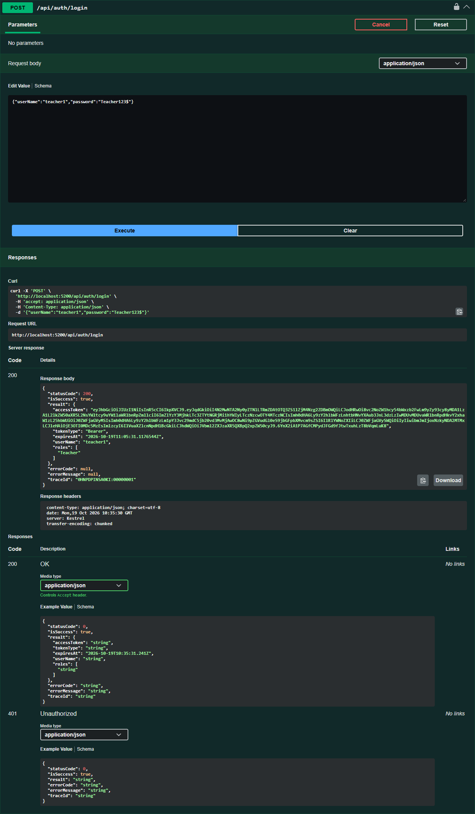

Запрос без токена:

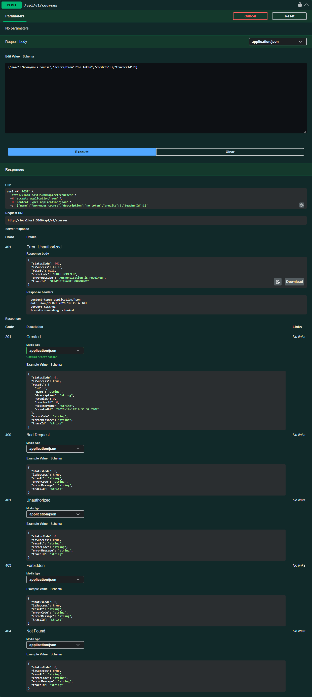

Преподаватель ставит оценку на своём курсе:

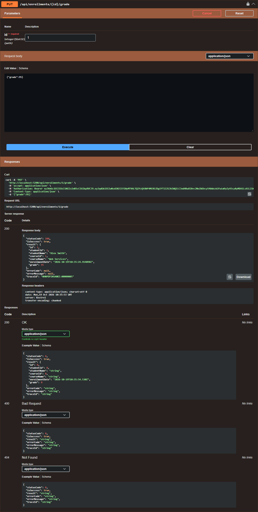

Тот же преподаватель на чужом курсе:

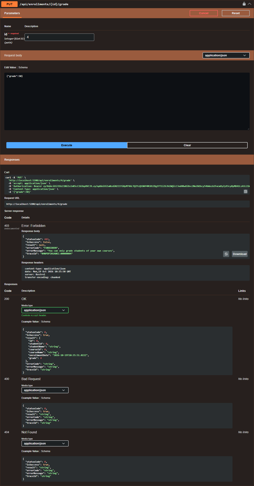

Вторая версия курсов:

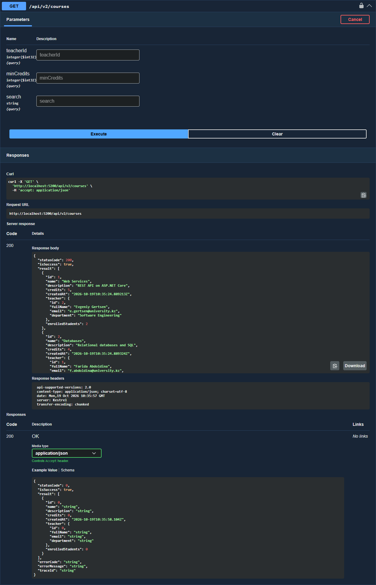

Клиентское приложение, список курсов:

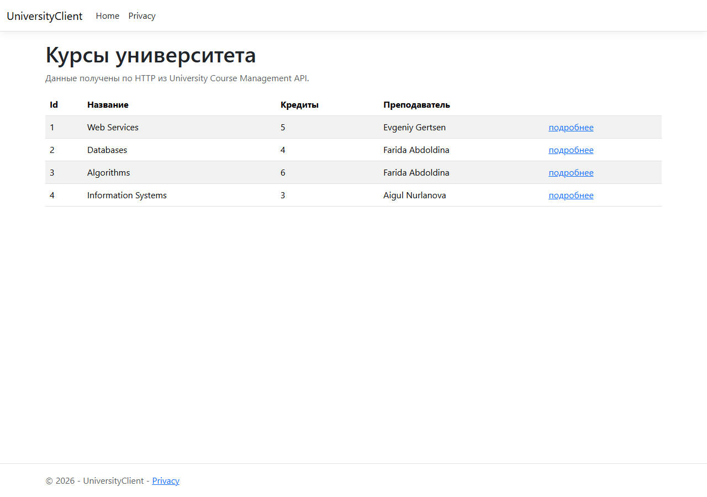

Клиентское приложение, карточка курса:

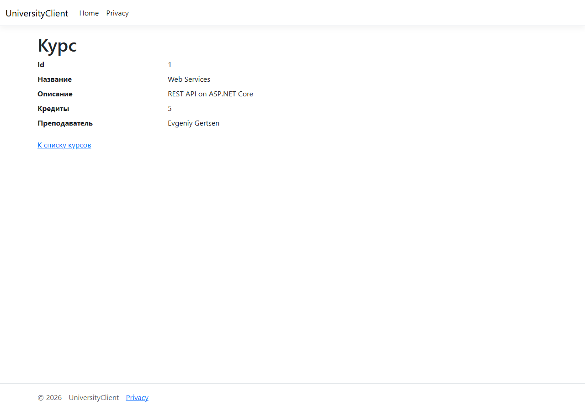
